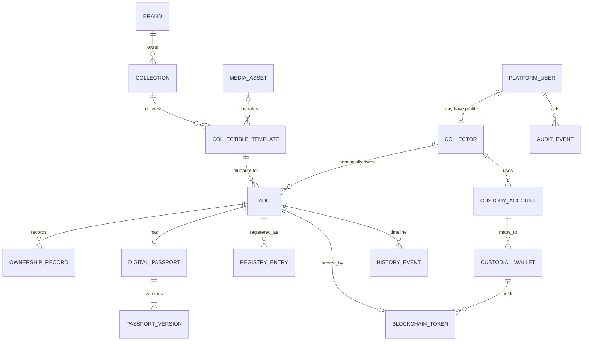
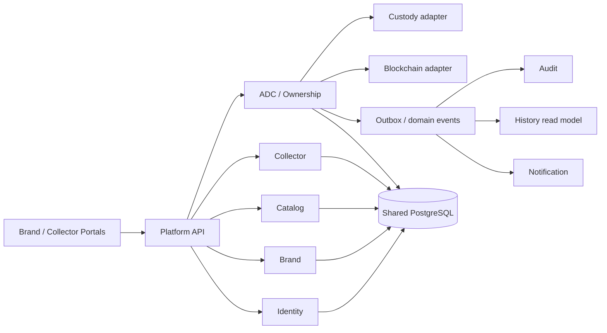
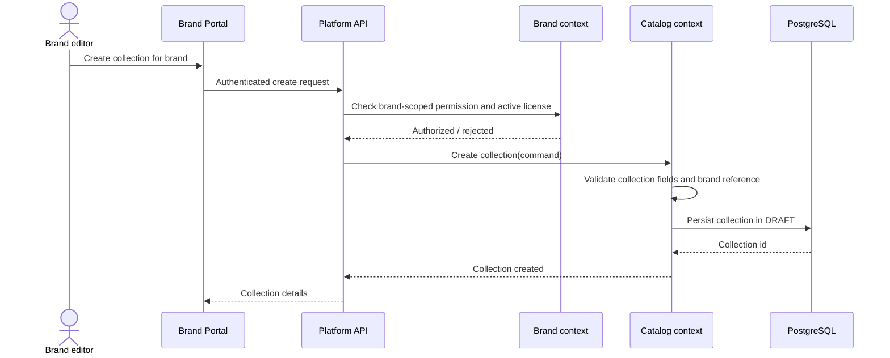
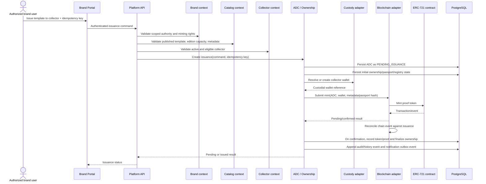
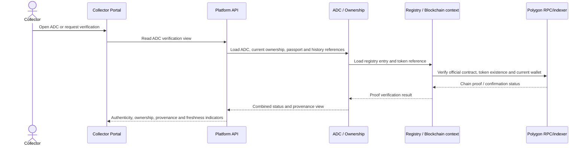
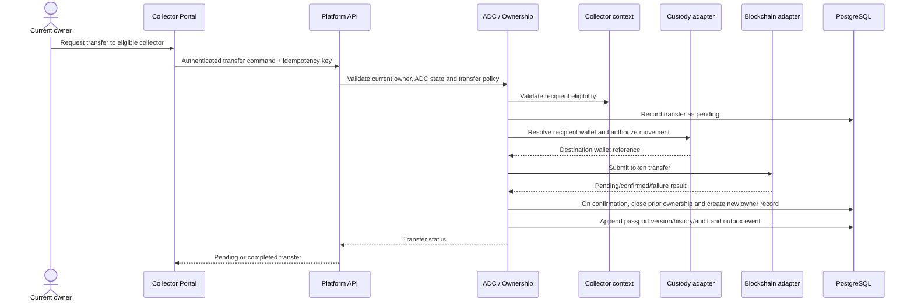

# MVP Domain and Architecture Validation

**Status:** Working design for review  
**Source:** `Collectable Platform Design & Tech Stack.docx`, sections 2.3, 2.5–2.17, and the service-boundary/ownership section  
**Purpose:** Validate the MVP domain model, module boundaries, deployment shape, and core flows before adding the next domain schemas or APIs.

## Design constraints from the source

- Deliver a modular monolith with clear bounded contexts; do not begin with a fleet of business microservices.
- Keep Collector and ADC separate: Collector owns the person/account and eligibility; ADC owns the issued asset and lifecycle.
- Treat the ADC as the business asset. Collections/templates define products; the blockchain token is proof, not the full collectible.
- Keep rich metadata, passport snapshots, registry records, custody mapping, and history off-chain. Use the blockchain for independently verifiable issuance, authenticity, ownership, and provenance proof.
- Model a Digital Passport as a current profile backed by immutable, versioned snapshots.
- Make issuance idempotent and asynchronous across custody/blockchain boundaries, with pending/failure states, reconciliation, and audit history.
- Defer marketplace, auctions, complex trading, AI recommendations, multi-chain support, and advanced fraud detection until core issuance, custody, ownership, verification, and registry flows work.

## High-level domain model

The diagram is conceptual, not a finalized relational schema. In particular, custody-account cardinality, token lifecycle cardinality, and the precise relationship between a registry entry and a passport version still require policy decisions. Domain ownership is:

| Aggregate/context | Owns and is authoritative for | Important boundary |
|---|---|---|
| Identity | Users, credentials, roles, permissions, scoped role assignments, authentication | Other contexts consume identity/authorization contracts, not identity persistence entities. |
| Brand | Brand licensing, brand users/governance | A brand-scoped role assignment supplies access scope; do not duplicate brand membership in another table. |
| Catalog | Collections, templates, edition rules, rarity/traits, metadata and media references | Templates are definitions and are not owned by collectors. |
| Collector | Collector profile, account status, KYC/onboarding/eligibility | ADC issuance asks Collector to validate eligibility; Collector does not own ADC state. |
| ADC and ownership | Issued ADC, lifecycle/authenticity state, ownership, provenance, freeze/recovery state, passports and registry entries | The ADC is the asset shown in a collector's Vault; never equate it with a template or token. |
| Custody | Custody accounts, provider references, wallets, key-management/recovery workflows | Private keys remain with the custody provider; a collector profile is not a wallet. |
| Blockchain registry | Contract/token references, mint/transfer transactions, token status and reconciliation | Blockchain proof does not store the full collectible or replace off-chain domain records. |
| History and audit | Immutable business history/read models; audit actor/action/object/time/source/correlation | History is a read model, not the authority for ownership, custody, trading, or chain state. |
| Notification | Delivery of business notifications | Consumes confirmed domain events; does not decide transaction success. |
| Marketplace/trading | Listings, offers, sales, trades and settlement | Deferred from the first MVP. |

The Users detail API allows authenticated self-view and platform identity administrator access to all of that user's active assignments and derived permissions. When a Brand Admin views another user, the user must have an active assignment in a managed Brand, and both assignments and derived permissions are limited to managed Brand scopes. Identity editing and the global role catalog remain restricted to `PLATFORM_IDENTITY:MANAGE`; Brand Admin grant/revoke controls use the existing Brand-scoped endpoints and assignable-role catalog.

The Users list returns one row per visible user for both platform identity administrators and Brand Admins, regardless of the number of roles or Brands. The Roles column summarizes visible assignments with their Brand names; individual assignments and revocation controls are available in Details. Brand Admin summaries never include assignments outside their managed Brands.

Both Brand detail screens also group the Users with access grid by user ID, summarizing roles while retaining per-role revoke actions. Their underlying Brand-scoped APIs continue returning individual assignments so mutations retain precise scope and assignment identity.

## Module boundaries and deployment

The target is one Maven module per business boundary, assembled into the deployable Platform API. Keep the shared PostgreSQL database for the MVP, but enforce ownership in code: a module writes its own tables and exposes application-level operations to other modules; callers should not reach into another module's repositories or JPA entities.

| Context | Current repository state | Target MVP placement |
|---|---|---|
| Identity | `collectb-identity` module | Keep as a reusable module. |
| Brand and Catalog | Brand implementation lives in `collectb-brand`; collection, template, and media-reference services live in `collectb-catalog`. | Keep Brand and Catalog as separate modules; preserve the Catalog-owned Brand policy port and Platform API adapter. |
| Collector | `collector` table exists in the platform changelog; no Collector Java module/service yet. | Add a `collectb-collector` module and compose it into Platform API. |
| ADC and Ownership | No implementation found in current module set. | Add a focused ADC/ownership module; keep the related aggregates internally cohesive while exposing separate ownership operations/contracts. |
| Custody and Blockchain | No integration module/service found. | Define adapter boundaries now; initially stub/simulate external operations for development. Deploy separately only when security, reliability, or operational ownership warrants it. |
| Audit, History, Notification | No modules found in current module set. | Keep event contracts and persistence ownership distinct. Start with reliable in-process/outbox delivery; separate workers/services when needed. |
| Platform API | `collectb-platform-api` is the Spring Boot application and composes Identity, Brand, and Catalog. | Remains the composition/deployment root for business modules; owns application configuration and shared Liquibase changelog. |
| Admin Portal | `collectb-admin-portal` Angular application | Separate frontend deployment; calls Platform API, not domain databases. |

This is a logical boundary diagram, not a claim that the adapters/workers or all modules already exist. For the MVP, business modules remain in one Platform API deployment. Custody/blockchain and notification/audit processing can become separate deployments when their operational needs justify it; avoid committing to microservice operations before then.

## Main sequence flows

### Create a collection

The collection belongs to a brand and is a catalog definition, not an owned asset. Template creation/publication follows as a separate Catalog operation: validate edition rules and metadata, attach media references, and enforce the documented template lifecycle before allowing issuance. Media storage can use the document's S3/CloudFront target; until that integration exists, retain a storage abstraction and checksum/reference rather than coupling the domain model to a provider.

### Issue an ADC, assign custody, and register blockchain proof

The command must be idempotent: a retry with the same key returns the existing issuance rather than creating another ADC/token. A created ADC remains `PENDING_ISSUANCE` until chain confirmation; a definitive failure becomes `ISSUANCE_FAILED` with an explicit retry/cancel path. Provider calls and database updates are not one transaction, so persist intent/outbox state and reconcile independently. Do not report a final issued/verified state solely because a provider submission was accepted.

### Verify authenticity, ownership, and provenance

The response should distinguish the platform's off-chain owner/beneficial-owner record from the on-chain wallet proof and indicate pending/stale/unavailable chain data rather than silently treating missing proof as success. Public collector history is role-filtered; operational/security events remain restricted to authorized support, brand, or compliance roles.

### Transfer ownership

The detailed transfer policy is not settled by the source document. The sequence therefore assumes a platform-authorized custodial transfer and leaves self-custody, marketplace settlement, reversals, and legal transfer restrictions for explicit policy design. Never change current ownership before authoritative transfer confirmation; make retries idempotent and reconcile ambiguous provider outcomes.

## Decisions to close before database/API implementation

1. Define edition reservation and serial-number allocation under concurrent issuance, including cancellation/retry behavior.
2. Confirm ADC, ownership, passport, registry, token, custody, freeze, recovery, and transfer state transitions and their authoritative source.
3. Decide whether the initial MVP uses a real custody/blockchain provider or a sandbox adapter, and define reconciliation/finality requirements.
4. Define what is anchored on-chain (at minimum a stable proof/reference or hash) and how passport/registry versions map to those anchors.
5. Decide the initial custody-account-to-wallet cardinality and whether transfers are restricted to platform custodial wallets.
6. Define role/permission checks for collection/template create, review, publish, and ADC issuance; preserve the rule that scope is separate from permission resource/action.
7. Define event/outbox retention, audit/history visibility, and notification delivery guarantees.
8. Define the module approach for Collector and future contexts, keeping module ownership explicit while sharing the MVP database.

## Prioritized MVP implementation backlog

| Priority | Work item | Dependencies | Exit criteria |
|---|---|---|---|
| P0 | Close the design decisions above that affect state, ownership, custody, and chain consistency. | This design review | Approved lifecycle/state transitions, issuance retry semantics, custody/chain sandbox-vs-provider approach, and ownership/passport proof rules. |
| P1 | Complete and verify the Brand/Catalog vertical slice in `collectb-catalog`: collection operations, media metadata/reference handling, template metadata and edition rules, and draft/review/publish lifecycle. | Brand module; existing Liquibase tables; P0 permission/lifecycle decisions | Authorized brand users can create and manage collections/templates; only a published template in a published collection is eligible for issuance. Expand automated coverage for lifecycle rejection paths and complete real MFA step-up and object-storage upload integrations. |
| P2 | Implement the Collector module over the existing `collector` table, including profile retrieval and explicit active/eligibility validation. | Identity; P0 collector eligibility rules | Collector API/service distinguishes an existing account from one eligible to receive an ADC; tests cover ineligible/suspended cases. |
| P3 | Add the ADC/Ownership module and off-chain issuance records: unique ADC identity/serial, issuance idempotency, ownership history, Digital Passport with immutable versions, and Registry Entry. | P1 published templates; P2 eligible collectors; P0 serial/state rules | Repeated issuance commands with the same idempotency key do not create duplicate ADCs; pending/failure/success transitions and passport versioning are tested without an external provider. |
| P4 | Add a custody port and development/sandbox adapter for collector-to-wallet resolution, account mapping, freeze/recovery hooks, and auditable outcomes. | P2; P3; P0 custody policy | Issuance can resolve a non-secret wallet/provider reference; provider failure is recoverable and never leaks key material. |
| P5 | Add the Blockchain adapter and proof-registration/reconciliation flow against the chosen sandbox or test network; define the ERC-721 interface and the minimal on-chain reference/hash. | P3; P4; P0 finality/anchor decisions | Issuance remains pending until verified confirmation; duplicate/replayed events are safe; failure and reconciliation behavior are tested. |
| P6 | Deliver collector Vault and verification read APIs that combine ADC, beneficial ownership, passport/registry, and chain-proof status. | P3; P5 | Collector can view an ADC and receive distinct authentic/ownership/provenance and pending/stale/unavailable proof indicators; access control is tested. |
| P7 | Add minimum audit/history event capture and notification after confirmed business outcomes; build timeline reads from authoritative records/events. | P3–P6; P0 visibility and event-delivery decisions | Critical issuance/assignment/transfer actions are auditable; timeline visibility is role-filtered; failed notification delivery does not undo a confirmed issuance. |
| Deferred | Marketplace, auctions, complex trading, AI recommendations, multi-chain, advanced fraud detection. | Core MVP proven | Do not start until issuance, custody, ownership, verification, and registry flows meet agreed acceptance criteria. |

Implement each priority as a tested vertical slice and preserve the module ownership rules above. The Catalog implementation slice is now in place; finish its remaining integration and test gaps before beginning ADC issuance. P2 remains the next product slice, and issuance must wait for both a validated published template and an eligible Collector contract.

## Current implementation gaps

- Catalog now provides Brand-scoped collection, collectible-template, and media-reference APIs, with draft/edit, review submission/withdrawal, independent review, approval, publication, retirement, and template cloning operations. Collection publication requires at least one published template. Approval, publishing, and retirement require MFA strength (`mfa` or `mfa_pwd`) except for the temporary development-only bypass described below.
- The Brand Portal now exposes collection/template management, review actions, traits editing, and media-reference registration. Integration tests exercise the main create-to-publish path, reject ordinary-password review, reject collection publication before a template is published, and reject cross-brand access.
- Media registration accepts an existing S3 or HTTPS reference and checksum; file upload, object existence/content verification, and S3/CloudFront integration are not implemented. Existing identity login tokens provide password strength only; real MFA step-up is not yet implemented.
- Temporary development MFA bypass: the default local profile is `development`, whose profile configuration sets `collectb.catalog.allow-development-mfa-bypass=true`. The backend exposes `catalogMfaRequired` via `/api/v1/me` so the portal uses the same policy and displays a persistent "MFA is mandatory for Production" warning. Permission, Brand scope, state, and independent-review checks remain enforced. Other profiles enforce MFA by default; enabling the bypass outside development or together with `prod`/`production` causes startup failure. Production deployment must explicitly activate its production profile (for example `SPRING_PROFILES_ACTIVE=production`), never rely on the local development default. Set the bypass property to `false` to restore strict enforcement in development.
- Collector has a database table only; no Collector application module/service or eligibility API exists.
- ADC, ownership, digital passport/version, registry, custody, and blockchain implementation are absent.
- Identity, Brand, Catalog, and Platform API are separate Maven modules; Collector, ADC/Ownership, Custody, Blockchain, History, Audit, and Notification remain future modules/adapters.
- The issuance, verification, and transfer sequences above are design artifacts, not implemented flows.
